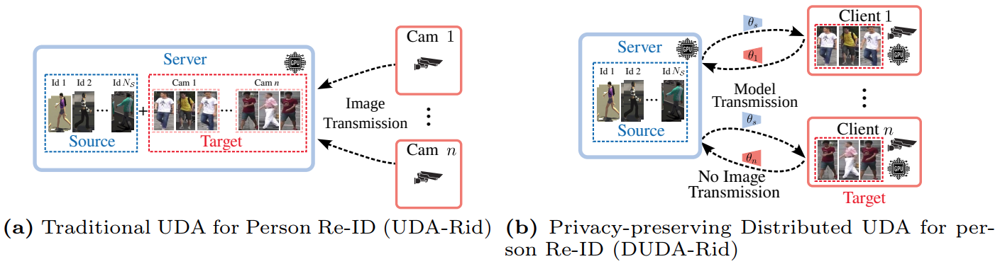
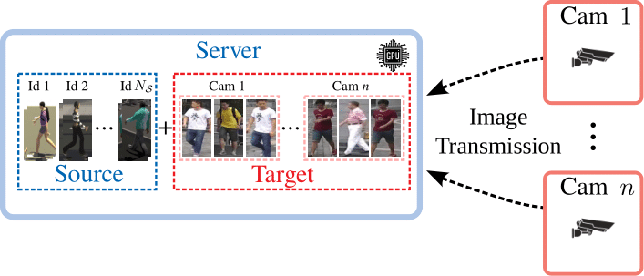
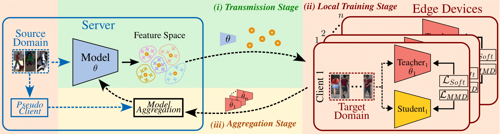

# Privacy-Preserving Adaptive Re-Identification without Image Transfer (Fed-Protoid)
This repository contains the code for the paper "Privacy-Preserving Adaptive Re-Identification without Image Transfer" (ECCV 2024).

# [Overview](#contents)

Re-Identification systems (Re-ID) are crucial for public safety but face the challenge of having to adapt to environments that differ from their training distribution.
Furthermore, rigorous privacy protocols in public places are being enforced as apprehensions regarding individual freedom rise, adding layers of complexity to the deployment of accurate Re-ID systems in new environments.

In this work, we present a novel setting for privacy-preserving Distributed Unsupervised Domain Adaptation for person Re-ID (DUDA-Rid) to address the problem of domain shift without requiring any image transfer outside the camera devices.
To address this setting, we introduce Fed-Protoid, a novel solution that adapts person Re-ID models directly within the edge devices.
Our proposed solution employs prototypes derived from the source domain to align feature statistics within edge devices.
Those source prototypes are distributed across the edge devices to minimize a distributed Maximum Mean Discrepancy (MMD) loss tailored for the DUDA-Rid setting.

Our experiments provide compelling evidence that Fed-Protoid outperforms all evaluated methods in terms of both accuracy and communication efficiency, all while maintaining data privacy.

<p align="center">
    
</p>
<!--   -->
<!-- <p float="left">
  >
</p> -->

For more details, please refer to our [paper]().

# [Framework Architecture](#contents)
<p align="center">
    
</p>

# [Updates](#contents)

[10/07/2024] `Fed-Protoid` v0.1.0 is released.

# [Installation](#contents)

```shell
conda create -n fedprotoid python=3.10 -y && conda activate fedprotoid
# 1. PyTorch + torchvision matching your CUDA version: https://pytorch.org
# 2. faiss, used for the k-reciprocal clustering distance
conda install -c pytorch faiss-gpu        # or: pip install faiss-cpu
# 3. this repository
pip install -r OpenUnReID/requirements.txt
pip install -e OpenUnReID                 # builds the Cython evaluation extension
```

More details in [INSTALL.md](OpenUnReID/docs/INSTALL.md).

## Data and weights

Paths are read from the config files and are resolved from the repository root.
The default layout is:

```
Fed-Protoid
├── data
│   ├── datasets
│   │   ├── market1501/Market-1501-v15.09.15
│   │   ├── msmt17/MSMT17_V1
│   │   └── cuhk03-np/labeled              # target of the Fed-Protoid++ config
│   └── pretrained
│       ├── resnet50-19c8e357.pth                       # ImageNet weights (Fed-Protoid)
│       ├── vit_small_ics_cfs_lup.pth                   # LUPerson self-supervised ViT-S (Fed-Protoid++)
│       ├── source_pretrain_msmt17/model_best.pth       # written by step 1 (Fed-Protoid)
│       └── source_pretrain_msmt17_vit/model_best.pth   # written by step 1 (Fed-Protoid++)
└── logs                                                # created by the training
```

+ `resnet50-19c8e357.pth` is the torchvision checkpoint:
  `https://download.pytorch.org/models/resnet50-19c8e357.pth`.
  Set `MODEL.backbone_path: ''` to let PyTorch download it instead.
+ `vit_small_ics_cfs_lup.pth` is the ViT-S with convolutional stem pre-trained
  on LUPerson, published by [TransReID-SSL](https://github.com/damo-cv/TransReID-SSL).
+ The source-domain models are produced by step 1 below.
+ Any of these locations can be changed in the config files or on the command
  line with `--data-root`, `--logs-root`, `--backbone-path` and `--source-pretrained`.

# [Get Started](#contents)
## 1. Source pre-training ("warm-up")
Supervised training on the labelled source domain, starting from the ImageNet
(Fed-Protoid) or LUPerson (Fed-Protoid++) weights:
```shell
export PYTHONPATH=$PWD/OpenUnReID
# Fed-Protoid (ResNet-50)
python -m torch.distributed.run --nproc_per_node=2 OpenUnReID/tools/source_pretrain/main.py \
    OpenUnReID/tools/source_pretrain/config.yaml --work-dir source_pretrain_msmt17 --launcher pytorch
# Fed-Protoid++ (ViT-S)
python -m torch.distributed.run --nproc_per_node=2 OpenUnReID/tools/source_pretrain/main.py \
    OpenUnReID/tools/source_pretrain/config_vit.yaml --work-dir source_pretrain_msmt17_vit --launcher pytorch
```
The best checkpoint lands where the federated configs expect it
(`data/pretrained/<work-dir>/model_best.pth`).

## 2. Federated training
To train Fed-Protoid on MSMT17 as source domain and Market1501 as target domain, run the following command:
+ Locally with multiple GPUs:
```shell
bash run_train.sh ${RUN_NAME} --epochs_s 1 --iters_s 0 --epochs_t 1 --times_itc 10
```
+ On a slurm cluster (adapt the `#SBATCH` lines to your cluster first):
```shell
mkdir -p logs && sbatch Fedprotoid.sh
```
## Arguments
+ `RUN_NAME`: the name of the experiment. Logs and checkpoints are saved in `${LOGS_ROOT}/${RUN_NAME}/` (`./logs/${RUN_NAME}/` by default).
+ `--epochs_s`: the number of source's training epochs.
+ `--iters_s`: the number of source's training iterations.
+ `--epochs_t`: the number of client's training epochs.
+ `--times_itc`: The number of iterations per round.
+ `--data-root`, `--logs-root`, `--backbone-path`, `--source-pretrained`: override the paths of the config files.
+ Environment variables read by `run_train.sh`: `METHOD` (`FEDPROTO` or `FEDPROTO++`), `GPUS` (default 2), `ROUNDS` (default 800), `CONFIG`, `PYTHON`, `SKIP_INIT=1` to resume a run. For instance:
```shell
METHOD=FEDPROTO++ GPUS=1 ROUNDS=50 bash run_train.sh ${RUN_NAME} --epochs_s 1 --epochs_t 1 --times_itc 10
```
+ [optional arguments]: please refer to [config.yaml](OpenUnReID/tools/FEDPROTO/config.yaml) to modify some key values from the loaded config of the specified method.

## Tests

```shell
pip install pytest
python -m pytest            # about 15 s on CPU, no GPU or dataset needed
python -m pytest -m e2e     # pre-training + federated rounds end to end on CPU, about 5 min
```

`tests/cpu_round.py` runs one client round of the training code on CPU with a
synthetic dataset. Use it to check that a change keeps the results identical:

```shell
python tests/cpu_round.py save before.json     # on the reference commit
python tests/cpu_round.py compare before.json  # after the change
```

# [Acknowledgement](#contents)

This repository is built upon [OpenUnReID](https://github.com/open-mmlab/OpenUnReID)